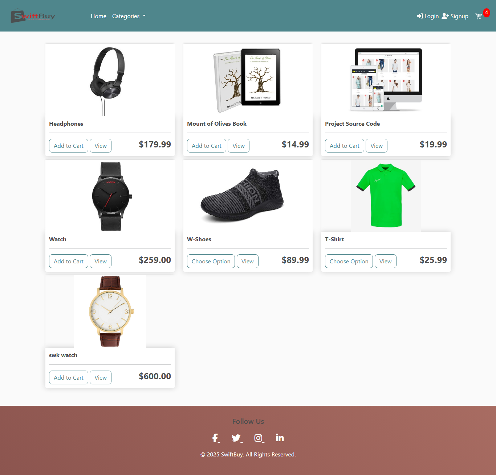
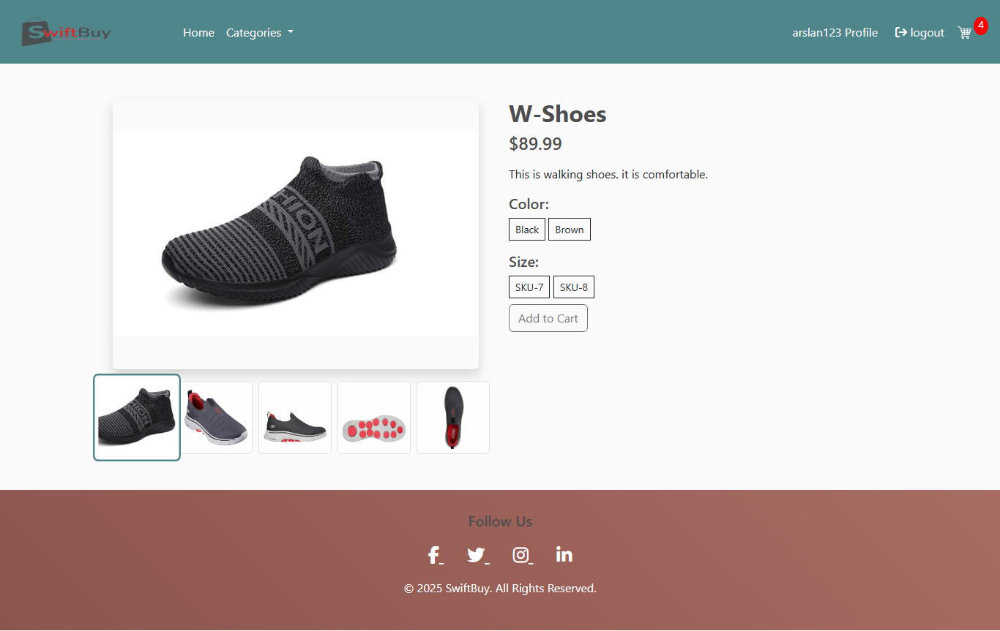
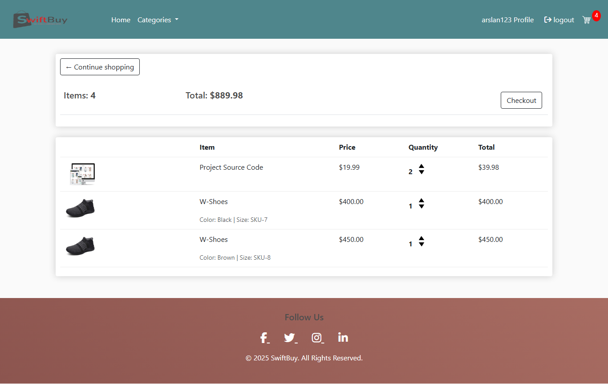
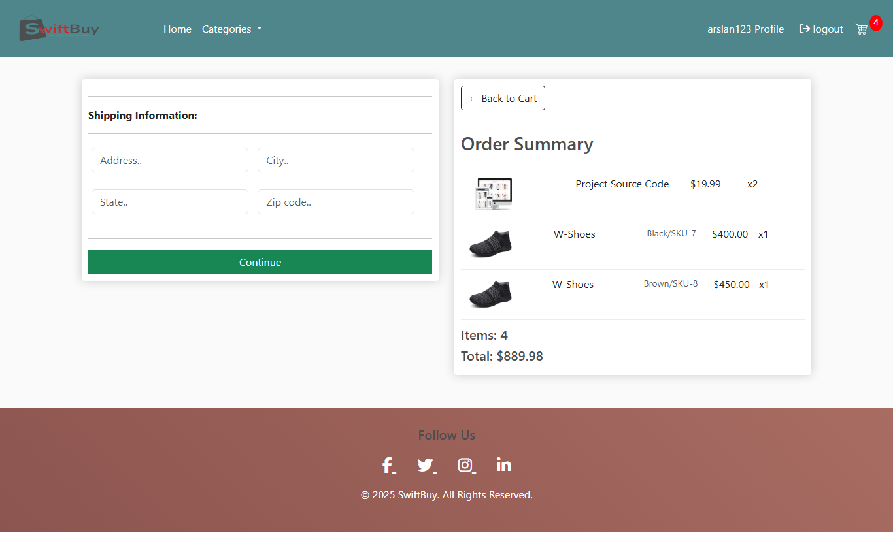
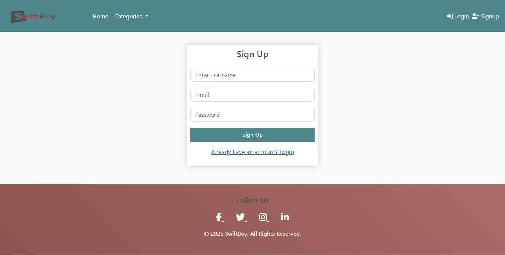

# Django Ecommerce Store

A full-featured online store built with **Django**. Customers can browse products by category, pick color and size variants, add items to a cart (even as guests), check out, and review their past orders. Store owners manage everything from the Django admin.

## Features

**Store and products**
- Product catalog with category filtering
- Product detail page with a main image and an extra image gallery
- Product variants (color and size), each with its own price and stock
- Digital and physical products (shipping details are only requested when needed)

**Cart**
- Add and remove items without reloading the page (JavaScript with AJAX)
- Guest carts stored in the session
- Guest cart merges into the user's cart on login or signup
- Stock checks: quantities are capped at available stock, and sold-out items are removed with a warning

**Checkout and orders**
- Guest checkout and logged-in checkout
- Order total is verified on the server before the order is completed
- Shipping address saved for physical items
- Stock is reduced automatically after a completed order

**Accounts**
- Signup, login, and logout
- Profile page with paginated order history
- Order detail view showing items, variants, and shipping address

**Admin**
- Manage products, categories, variants, extra images, orders, and customers through the Django admin

> Note: payment is simulated. Checkout marks the order as complete but does not connect to a real payment gateway.

## Tech stack

- Python 3, Django 5.2
- SQLite
- HTML, CSS, JavaScript
- Pillow (image uploads)

## Getting started

### 1. Clone the repository

```bash
git clone https://github.com/afzal304/django-ecommerce-store.git
cd django-ecommerce-store
```

### 2. Create and activate a virtual environment

Windows (PowerShell):

```powershell
python -m venv venv
.\venv\Scripts\Activate.ps1
```

macOS / Linux:

```bash
python3 -m venv venv
source venv/bin/activate
```

### 3. Install dependencies

```bash
cd ecommerce
pip install -r requirements.txt
```

### 4. Set up the database

```bash
python manage.py migrate
python manage.py createsuperuser
```

### 5. (Optional) Set your own secret key

The project falls back to a development key. For anything beyond local testing, set your own:

Windows (PowerShell):

```powershell
$env:DJANGO_SECRET_KEY = "your-long-random-key"
```

macOS / Linux:

```bash
export DJANGO_SECRET_KEY="your-long-random-key"
```

### 6. Run the server

```bash
python manage.py runserver
```

Open **http://127.0.0.1:8000/** in your browser.

### 7. Add some products

1. Go to **http://127.0.0.1:8000/admin/** and log in with your superuser account.
2. Create a **Category**.
3. Create a **Product** (set price, stock, and image) and, if you like, add **Variants** and extra **Product images**.
4. Visit the home page to see your products.

Customers create their own accounts at `/signup/`. Admin and staff accounts cannot log in through the customer login page.

## Project structure

```
ecommerce/
├── manage.py
├── requirements.txt
├── ecommerce/          # project settings and root URLs
├── store/              # main app
│   ├── models.py       # Customer, Category, Product, Variant, Order, OrderItem, ShippingAddress
│   ├── views.py        # store, cart, checkout, auth, profile views
│   ├── utils.py        # cart and session helpers
│   ├── urls.py
│   └── templates/store/
└── static/
    ├── css/
    ├── js/cart.js      # cart actions (AJAX)
    └── images/
```

## Main URLs

| URL | Page |
|---|---|
| `/` | Store home with category filter |
| `/product/<id>/` | Product detail |
| `/cart/` | Shopping cart |
| `/checkout/` | Checkout |
| `/profile/` | Order history (login required) |
| `/login/`, `/signup/`, `/logout/` | Authentication |
| `/admin/` | Django admin |

## Screenshots

_Add screenshots of your store here, for example:_









## Possible improvements

- Connect a real payment gateway
- Add product search and sorting
- Add order status tracking and email confirmations
- Add automated tests

## License

This project is for learning and portfolio purposes. Add a license of your choice if you want others to reuse it.
